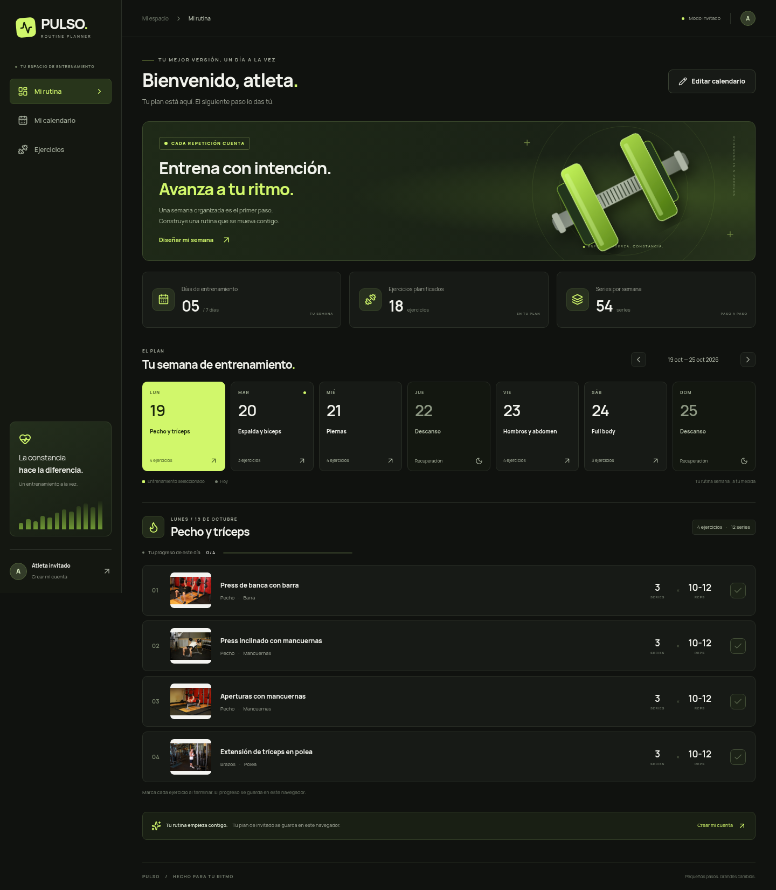
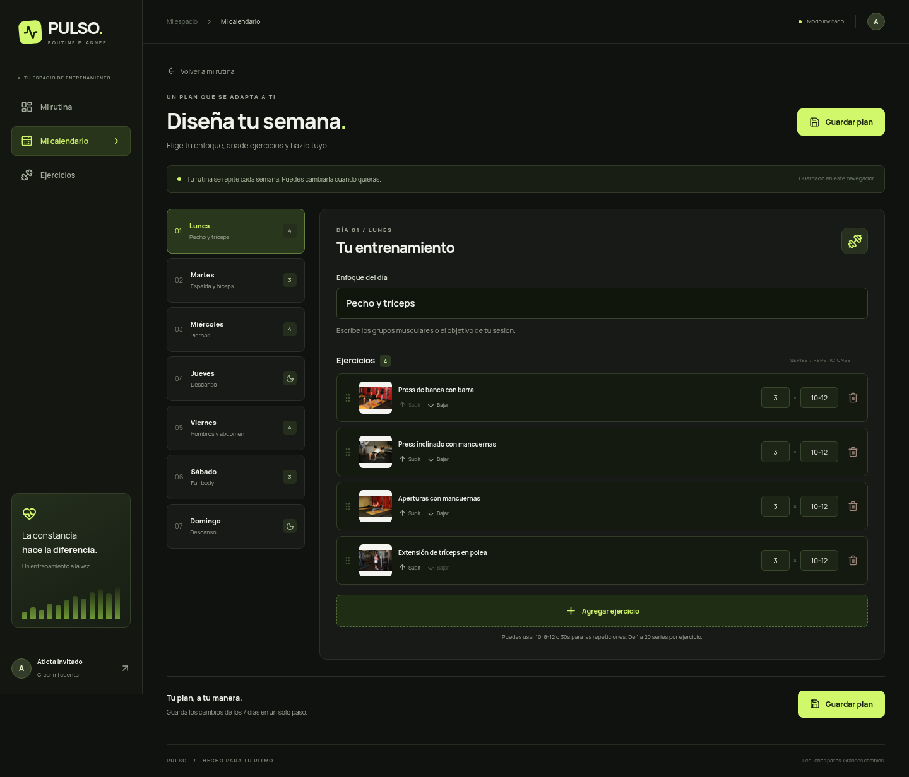
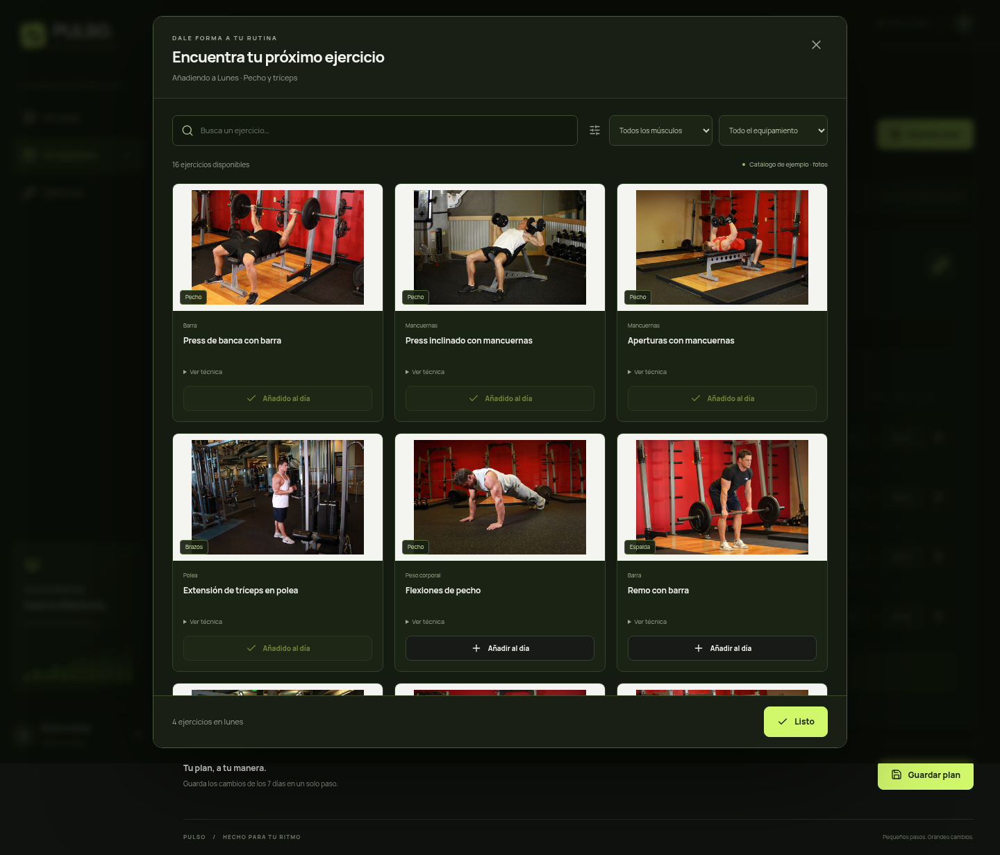
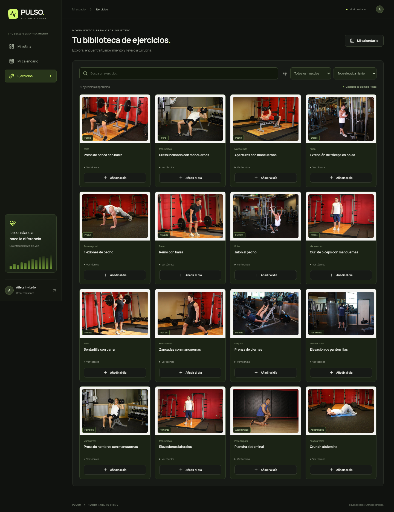
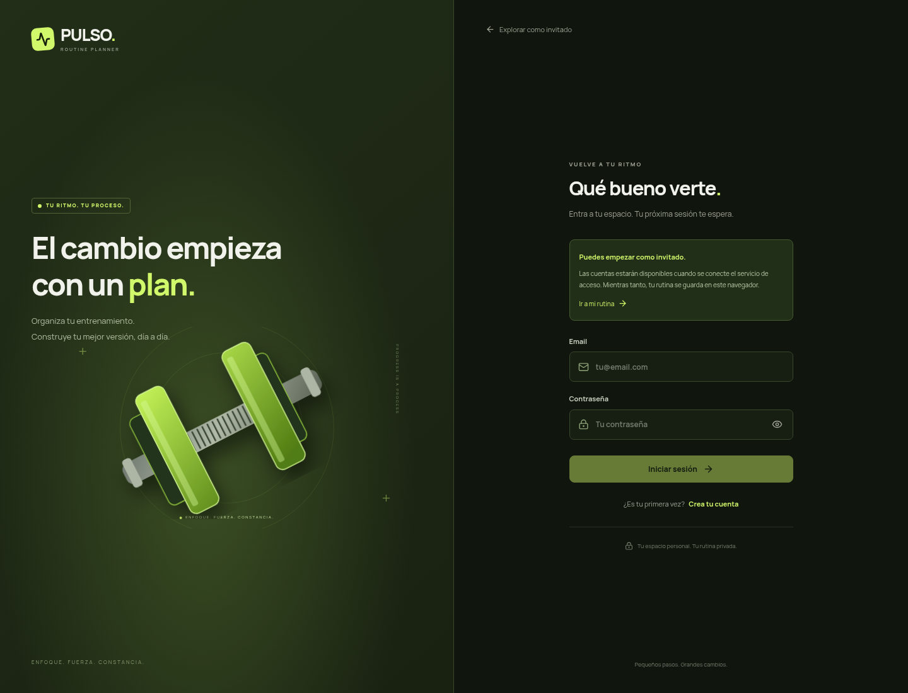
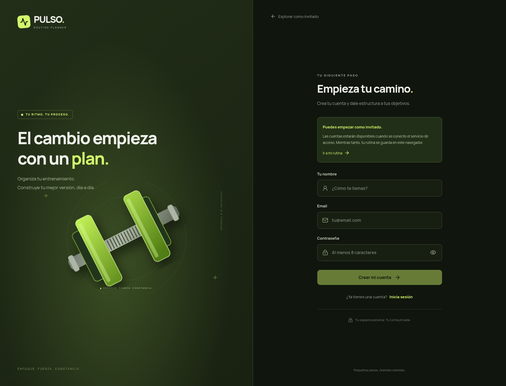
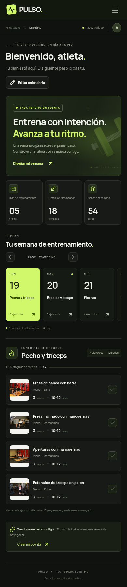
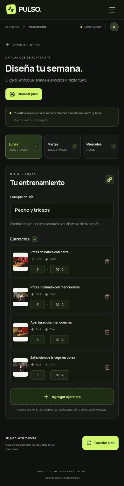

# Pulso · Vista previa

Capturas reales de la aplicación ejecutándose en Chromium. Se conserva el recorrido del wireframe: inicio → calendario → selección de ejercicios. Las capturas muestran el modo invitado; no son un despliegue público.

[Volver a la guía](../README.md) · [Descargar proyecto](https://github.com/sebastian01-vs/WebEjercicios/archive/refs/heads/main.zip)

## Inicio · escritorio

## Editar calendario · escritorio

## Selección de ejercicios

## Biblioteca de ejercicios

## Iniciar sesión

## Crear cuenta

## Inicio · móvil

## Editar calendario · móvil

